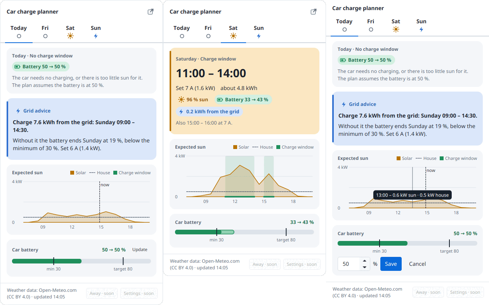

# Car charge planner

[](https://github.com/Enadeag/car-charge-planner/actions/workflows/ci.yml)
[](LICENSE)


A tray app for Linux and Windows desktops that tells you when to charge your electric car so that as much of your own solar energy as possible is used and as little as possible is fed back to the grid.

It is advisory only: it recommends a **charge window** and a **charge power**, and you set the current in your charger's app yourself.

It plans from a description of your set-up: your solar panels (size, tilt, direction), your location, your home charger's current limits and your car's battery. You enter it in set-up the first time and change it in Settings later. Where you do not know a value, the app uses a **typical value** and says so: replace it with yours, or the plan will not fit your home.

It suits a fixed-price energy contract, where the goal is simply to use your own solar power instead of feeding it back. It does not look at hourly energy prices.

<picture><source media="(prefers-color-scheme: dark)" srcset="docs/screenshots/java/charts-dark.png"></picture>

The pictures are of an example home; a real desktop theme looks a little different.

## Supported systems

| System | Status |
| --- | --- |
| **Linux, KDE Plasma** (x64) | Supported. KDE Plasma under Wayland is where the app is developed and used. |
| Linux, GNOME | Untested. GNOME has no tray of its own: the app shows a window, or a tray icon with the AppIndicator extension. |
| Other Linux desktops (XFCE, Cinnamon, Sway, X11 sessions and so on) | Untested. A tray icon needs a desktop with a system tray (StatusNotifierItem); without one the app shows a window. |
| **Windows 10 or later** (x64) | Supported, with an installer. |
| macOS | Not built. |

"Supported" means a person has checked every release on that system.

Tried it on your desktop? Please tell us, whether it works or not, with the **Does it work on my desktop?** issue form.

## What it does

- Fetches a solar forecast from a forecast provider ([Open-Meteo](https://open-meteo.com) by default, or [Forecast.Solar](https://forecast.solar); both free, no account) and turns it into expected surplus: panel output minus the house's own use. A second provider can be set as a fallback.
- Recommends charge windows within the hours the car is at home, with one constant power per window (in amps and kW), aiming for almost no grid draw.
- **Grid advice:** if the battery would end a day below your minimum charge level, it says how much to charge from the grid and when.
- A tray icon whose dot shows the state of the plan, with the plan in its tooltip. Click it for the **dashboard**: a tab per day with that day's charge window, grid advice, the expected sun against the house's use, and the car battery. The dashboard also opens in a window of its own.
- **Update** on the battery card is where you enter the level the car shows. Until you do, the plan assumes 50 % and says so.
- Right-click the icon for **Open dashboard**, **Settings…** (**Set up…** until the app is set up), **About…** and **Quit**.
- Sends a desktop notification a few minutes before each window (the lead time is a setting), once per window. Clicking it opens the dashboard. On Linux notifications go straight to the desktop's notification service over D-Bus, so they work with or without a tray; on Windows they come from the tray icon.

## Current state

The planner, the dashboard, the tray icon, the notifications, set-up and Settings work. The app was first written in Python with Qt and has been rewritten in Java with JavaFX ([ADR 0005](docs/adr/0005-java-with-javafx.md)); the reasoning behind the original design is in [docs/design](docs/design/README.md).

Limits to know about:

- **The plan is forecast-only.** It uses a weather forecast and the values you enter, not measured data: no smart-meter, inverter or car readings. The more accurate your panel, battery and consumption values, the better the plan.
- **You enter the battery level by hand**, and the times the car is away as weekly times in Settings. There is no calendar sync and no connection to the car.
- **You set the charge current yourself**, in your charger's own app. The app only recommends it.
- **Settings of the Python version (0.2.0 and earlier) are not read.** Run set-up once; the old files are left alone.

## Install

The downloads are on the [release page](https://github.com/Enadeag/car-charge-planner/releases). Each brings its own Java runtime: nothing else needs to be installed. Internet access is needed for the forecast; without it the app uses its cached forecast and says so.

### Windows

Download `car-charge-planner-<version>.exe`. The installer needs no administrator rights. It installs for you only, in `%LOCALAPPDATA%\Programs\car-charge-planner`, and adds a Start menu entry and a desktop shortcut. The first start opens set-up.

**Check the download.** In PowerShell, in the download folder, run `(Get-FileHash .\car-charge-planner-<version>.exe -Algorithm SHA256).Hash` and compare it with the line for the installer in `SHA256SUMS` from the same release (`Get-Content .\SHA256SUMS`). Capitals don't matter. If they differ, delete the file and download it again.

**"Windows protected your PC".** The installer is not code-signed yet (that waits for SignPath), so Microsoft Defender SmartScreen warns about a new download from an unknown publisher. Once the checksum matches, click **More info**, then **Run anyway**.

**Update:** quit the app (tray icon, **Quit**), then run the new installer. It replaces the old version and keeps your settings.

**Uninstall:** in Settings, Apps, Installed apps. This removes the program and its shortcuts. It keeps your settings, data and API keys: the folders are listed under [Where things are kept](#where-things-are-kept), and the keys are in Credential Manager. Delete them if you want them gone.

**Coming from 0.2.0?** That version was a different program, in `%LOCALAPPDATA%\Programs\Car charge planner`. The new installer does not remove it: uninstall it in Settings, Apps.

### Linux

Download `car-charge-planner-<version>-linux.tar.gz` and `SHA256SUMS`, check the download and unpack it where you keep programs:

```bash
sha256sum --ignore-missing -c SHA256SUMS
tar -xzf car-charge-planner-<version>-linux.tar.gz -C ~/.local/opt    # or any folder you like
~/.local/opt/car-charge-planner/bin/car-charge-planner
```

The first start opens set-up. The archive is not signed yet either.

**Update:** quit the app, replace the folder with the new one, and start it again. If it starts at login, switch that off and on again when the folder moved.

**Uninstall:** switch off start at login (Settings, App), quit the app and delete the folder. Your settings and data stay where they are, listed under [Where things are kept](#where-things-are-kept); delete them if you want them gone.

## Run

Start the app from the Start menu (Windows) or with `bin/car-charge-planner` in the unpacked folder (Linux). It runs until you choose **Quit** in the tray icon's menu, or closes with its window when it shows a window instead of a tray icon. Starting it again while it runs does not start a second copy: the running one shows its dashboard.

The program also takes a few commands:

| Command | What it does |
| --- | --- |
| `car-charge-planner quit` | Asks the running app to quit. |
| `car-charge-planner start-at-login on` | Starts the app at login, hidden in the tray. The same as the switch in Settings, App. |
| `car-charge-planner start-at-login off` | Stops starting it at login. |
| `--config=path/to/engine.json` | Plans with another config file, such as `docs/example-engine.json`. |

### First run

Until you have said where your panels are, the app knows nothing about you: it **fetches nothing** (no request leaves your computer) and there is no plan. Set-up opens by itself the first time, and the dashboard and the tray menu lead back to it until it is done.

Set-up takes a few minutes. It starts with what leaves your computer, then asks for your language and units, the **place** of your panels (searched by name, or typed as coordinates), the panels' **size, direction and tilt** (more than one array if your panels face different ways), your **car** and **charger**, the forecast provider, and optionally more, such as the house's own use and when the car is away. Every question says where to find the answer, and a typical value is used where you don't know one. Before Finish it checks the forecast and shows a preview of the dashboard. **Nothing is saved until Finish**: cancelled, the app stays not set up.

<p>


</p>

When the app is started hidden at login, set-up does not open by itself; one notification offers it.

## Settings

Open **Settings…** from the tray menu or the dashboard. Settings is a window with a page per category: Solar panels, Location, Car and house, Charger, Forecast, Away, Planning, App and About.

| Page | What it holds |
| --- | --- |
| Solar panels | The panel arrays: size, tilt, direction and losses of each. The forecast is the sum of the arrays. |
| Location | Latitude, longitude and time zone, or a place search. |
| Car and house | The car's usable battery, consumption and driving per day; the house's own use. |
| Charger | One or three phases, minimum and maximum current, voltage, charging efficiency. |
| Forecast | Which forecast provider to use, an optional fallback, and each one's settings (a server address or an API key, if it takes any), with a **Test** button. API keys are kept in the system keychain. |
| Away | The weekly times the car is not at home. |
| Planning | Minimum and target charge level, the planning margin, the import tolerance, the shortest window, the notification lead time. |
| App | Language, light or dark, units (metric or imperial), whether the app shows a tray icon or a window, and start at login. Set-up can be run again from here. |
| About | The version, the licence, the source, and where your files are kept. |

**Save** checks everything together. If something is wrong, it says what and writes nothing; otherwise the change applies at once. How the app shows itself (tray icon or window) applies the next time it starts.

## Where things are kept

| What | Linux | Windows |
| --- | --- | --- |
| Config: your system, planning preferences, forecast providers and weekly away times | `~/.config/car-charge-planner/engine.json` | `%APPDATA%\car-charge-planner\engine.json` |
| The app's own settings (language, appearance, units, tray or window) | `~/.config/car-charge-planner/app.json` | `%APPDATA%\car-charge-planner\app.json` |
| The battery level you entered last | `~/.local/share/car-charge-planner/battery.json` | `%LOCALAPPDATA%\car-charge-planner\battery.json` |
| Away periods for a specific day | `~/.local/share/car-charge-planner/away.json` | `%LOCALAPPDATA%\car-charge-planner\away.json` |
| The windows you were notified about | `~/.local/share/car-charge-planner/announced.json` | `%LOCALAPPDATA%\car-charge-planner\announced.json` |
| Forecast cache, one file per provider | `~/.local/share/car-charge-planner/forecasts/` | `%LOCALAPPDATA%\car-charge-planner\forecasts\` |
| API keys | The system keychain; `~/.config/car-charge-planner/secrets.json` (readable only by you) only where there is none | Credential Manager |
| Start at login | `~/.config/autostart/car-charge-planner.desktop` | The `Run` key of your user in the registry |

On Linux `XDG_CONFIG_HOME` and `XDG_DATA_HOME` move the config and data folders, as usual. On Windows, `%APPDATA%` is usually `C:\Users\<you>\AppData\Roaming` and `%LOCALAPPDATA%` is `C:\Users\<you>\AppData\Local`. Settings, About lists the folders of your computer.

`docs/example-engine.json` shows every setting of `engine.json`, for a made-up place. The app reads the files when it starts and writes them whole when you save; edit one by hand only while the app is closed. Delete the data folder to reset your entries and the cache.

## How it plans, briefly

1. Surplus per step = the forecast provider's expected solar power minus the house's own use, scaled by a planning margin (85% by default) so it errs towards too little power rather than grid draw.
2. A step counts only if the surplus covers at least your charger's minimum current (6 A by default: about 1.4 kW on a single-phase 230 V charger, about 4.1 kW on a three-phase one).
3. Within the hours the car is home, it picks the window and power that bring in the most solar for the energy the car needs, up to your target charge level (80% by default).
4. It projects the battery day by day, subtracting your driving per day. If a day would end under your minimum charge level, it adds grid advice.
5. A window you have been notified about is kept as announced while it runs, so the power on screen matches what you set.

The words used here (surplus, charge window, away period and so on) are defined in [CONTEXT.md](CONTEXT.md).

## Contributing

Bug reports, desktop reports, translations and pull requests are welcome: start with [CONTRIBUTING.md](CONTRIBUTING.md), which also says how to build and run the app from a clone. Please follow the [Code of Conduct](CODE_OF_CONDUCT.md); report security problems as described in [SECURITY.md](SECURITY.md). What changed in each release is in the [changelog](CHANGELOG.md).

## Licence

Copyright (C) 2026 Kelvin Vroegop. Car charge planner is free software under the [GNU General Public License](LICENSE), version 3 or (at your option) any later version, with additional terms under sections 7(b) and 7(c) that ask modified versions to keep the author attribution in their About screen: see [ADDITIONAL-TERMS.md](ADDITIONAL-TERMS.md). The short notice is in [NOTICE](NOTICE). Version 0.1.0 was released under the MIT licence; later versions are under the GPL.

## Data and privacy

The app runs on your computer and has no account, no telemetry and no update check. This is everything that
leaves it, and everything it keeps.

### What is sent, and to whom

Only the **forecast provider** you chose (and the fallback, if you set one) is contacted, and only to ask for a
forecast. Whatever you ask it, it also sees your internet address, as any website does. Set-up's first step says
what the chosen provider is sent. What each one is sent, and the terms that go with using it (read on 2026-10-07;
the providers can change them):

| Provider | What is sent | Free plan | Credit shown in the app | Terms |
| --- | --- | --- | --- | --- |
| Open-Meteo | Your location (latitude and longitude), your time zone and the tilt and direction of your panels. With an API key, the key too. | Non-commercial use only, under 10,000 requests a day. The app asks once for each panel array. | Weather data: Open-Meteo.com (CC BY 4.0) | [open-meteo.com/en/terms](https://open-meteo.com/en/terms) |
| Forecast.Solar | Your location (latitude and longitude), the tilt and direction of your panels and their size in kWp. With an API key, the key too. | The public plan needs no key: today and tomorrow, one plane, 12 requests an hour for everything behind the same internet address. The app asks once for each panel array. | Solar forecast: Forecast.Solar | [doc.forecast.solar/account_models](https://doc.forecast.solar/account_models) |

- **Commercial use.** The free plans are for personal use. If you use the app for a business, take the provider's
  own commercial plan or run your own server (Open-Meteo can be self-hosted or taken as a paid plan, with its own
  server address and key: both go in Settings, on the Forecast page). Forecast.Solar's pages do not say whether the
  public plan may be used commercially; ask them.
- **Credit.** The credit above is shown on the dashboard next to the age of the forecast, because both providers ask
  for it (Open-Meteo's data is CC BY 4.0). It is shown for whichever provider made the forecast on screen.
- **Place search.** The place you type in the search box of set-up's or Settings' Location page is sent to the place
  search of the forecast provider you have chosen (Open-Meteo by default), which answers with matching places and
  their coordinates. The page says so. A provider without a place search is never sent it: you type coordinates
  instead. The place names come from [GeoNames](https://www.geonames.org) (CC BY 4.0), via Open-Meteo.
- **Nothing else.** The battery level, your away times, your panels' size (except to Forecast.Solar, which needs
  it), the house and car settings and the plan itself never leave the computer.
- **Local only.** Notifications go through your desktop's own notification service. A second start finds the
  running app through a socket in a folder only you can open. Nothing listens on the network.

### What is kept, and where

See [Where things are kept](#where-things-are-kept). In short: your settings and, if you use a paid plan, your API
keys (in the system keychain, never in the settings file); your battery level and away times; the windows you were
notified about; a cache of the last forecast of each provider. Delete any of them to start over.

API keys are kept by the system, not in a file:

| System | Where the keys are kept |
| --- | --- |
| Linux | The Secret Service: GNOME Keyring, KWallet or another that offers it, as items with the attribute `application` set to `car-charge-planner` |
| Windows | Credential Manager (Windows Credentials), as generic credentials whose names start with `car-charge-planner:` |

The entries are named `forecast/<provider>/<key>`, and one more entry, `index`, lists the names (no values) because a
keychain cannot be asked what it holds. Without a usable keychain (a Linux machine with no Secret Service, for one)
the keys are kept in `secrets.json` beside `engine.json`, readable only by you, and the app says so.

### Third-party software

The downloads bring these with them:

| Software | Used for | Licence |
| --- | --- | --- |
| The Java runtime ([OpenJDK](https://openjdk.org), cut down with jlink) | Running the app | GPL-2.0-only with the Classpath Exception |
| [JavaFX](https://openjfx.io) | The dashboard, set-up and Settings | GPL-2.0-only with the Classpath Exception |
| [AtlantaFX](https://github.com/mkpaz/atlantafx) | The look of the windows, light and dark | MIT |
| [dbus-java](https://github.com/hypfvieh/dbus-java) | The tray icon, notifications and the keychain on Linux | MIT |
| [Jackson](https://github.com/FasterXML/jackson) | Reading and writing the JSON files and the providers' answers | Apache-2.0 |
| [SLF4J](https://www.slf4j.org) | dbus-java's log, passed on to the app's | MIT |

The runtime's own notices are in `lib/runtime/legal` of the Linux folder (`runtime\legal` in the Windows install
folder). For development only: [JUnit](https://junit.org) (EPL-2.0), [AssertJ](https://assertj.github.io/doc/)
and [ArchUnit](https://www.archunit.org) (both Apache-2.0).

The weather and solar data come from the providers above under their own terms. The recorded answers the tests
use are credited in
[`src/test/resources/.../forecast/providers/NOTICE.md`](src/test/resources/io/github/enadeag/carchargeplanner/engine/forecast/providers/NOTICE.md).

## Attribution

Weather data by [Open-Meteo.com](https://open-meteo.com), licensed CC BY 4.0, used here for non-commercial personal use. Place data: [GeoNames](https://www.geonames.org), via the Open-Meteo geocoding service. Solar forecasts by [Forecast.Solar](https://forecast.solar).
