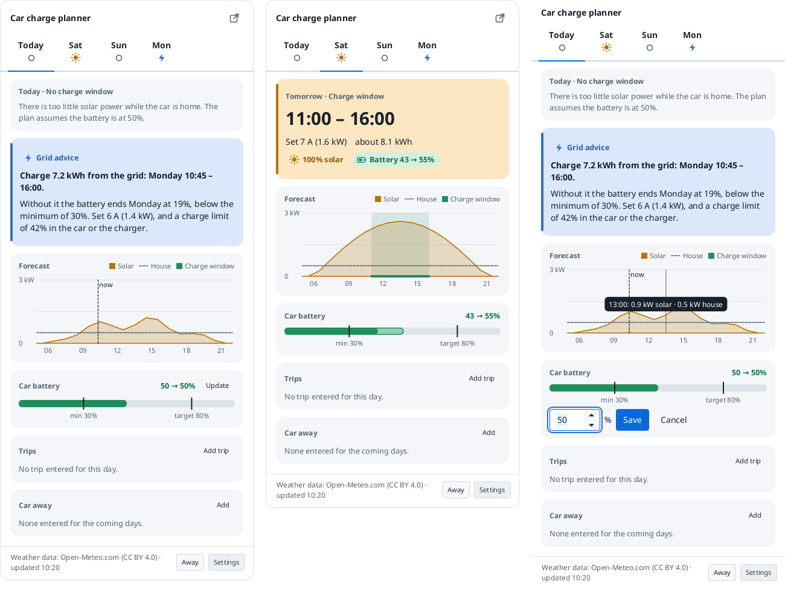

# Car charge planner

A desktop app for Linux and Windows that tells you when to charge your electric car so that as much of your own solar energy as possible is used and as little as possible is fed back to the grid. It suits a fixed-price energy contract: it does not look at hourly energy prices.

There is also an **Android app**, the same planner on your phone. It works without the desktop app and without a server: it fetches the forecast and makes the plan itself, and tells you before a charge window starts, also while it is closed. It is described under [The Android app](#the-android-app).

It is advisory only: it recommends a **charge window** and a **charge power**, and you set the charge current in your charger's app yourself.

It plans from a description of your set-up: your solar panels (the number of panels, their direction and tilt, and the year they were placed or their power per panel), your location, the power your car charges with at home and your car's battery, entered in set-up and changed in Settings later. Where you do not know a value, the app uses a **typical value**: replace it with yours when you know it, or the plan will not fit your home.

<picture><source media="(prefers-color-scheme: dark)" srcset="docs/screenshots/java/charts-dark.png"></picture>

The pictures are of an example home; a real desktop theme looks a little different.

## What it does

- Turns a solar forecast ([Open-Meteo](https://open-meteo.com) by default, or [Forecast.Solar](https://forecast.solar); both free, no account; a second can be a fallback) into expected surplus: panel output minus the house's own use (a typical household's until you enter yours).
- Recommends charge windows within the hours the car is at home, with one constant power per window (in amps and kW), aiming for almost no grid draw.
- **Grid advice:** if the battery would end a day below your minimum charge level, it says how much to charge from the grid and when.
- **Trips:** enter a drive with its departure, return and distance, and the plan makes sure the battery holds enough at the departure, with advice and notifications for the charge and the charge limit to set.
- Shows the plan in a tray icon and on the **dashboard**, and notifies you a few minutes before each window.
- Reads nothing from the car: you enter the battery level by hand. Reading it from the car is not planned for now; [ADR 0006](docs/adr/0006-integrations-built-in.md) records which car makers offer their owners an official route.

**Current state:** all of this works, in the desktop app (Java with JavaFX, [ADR 0005](docs/adr/0005-java-with-javafx.md)), released for Linux and Windows, and in the Android app ([ADR 0010](docs/adr/0010-android-app.md)), first released on 2026-11-13. This page describes the code on `main`; where the latest desktop release does something else, the Unreleased part of the [changelog](CHANGELOG.md) says what. Mind the [limits](docs/guide.md#limits-to-know-about).

## Supported systems

| System | Status |
| --- | --- |
| **Linux, KDE Plasma** (x64) | Supported. Developed and used under Wayland. |
| Linux, GNOME | Untested. No tray of its own: the app shows a window, or a tray icon with the AppIndicator extension. |
| Other Linux desktops (XFCE, Cinnamon, Sway, X11 sessions and so on) | Untested. Without a system tray (StatusNotifierItem) the app shows a window. |
| **Windows 11** (x64) | Supported, with an installer. |
| Windows 10 (x64) | Untested. The same installer, but nobody has confirmed it on Windows 10 yet. |
| **Android 10 or newer** | Each release is checked by hand on a real phone: see [The Android app](#the-android-app). |
| macOS | Not built. |

"Supported" means a person has checked every release on that system. Tried it on your desktop? Please tell us, whether it works or not, with the **Does it work on my desktop?** issue form.

## Install

Download from the [release page](https://github.com/Enadeag/car-charge-planner/releases); each download brings its own Java runtime.

- **Windows:** run `car-charge-planner-<version>.exe`, which needs no administrator rights. It is not code-signed yet: [check the download](docs/install.md#check-a-download) first.
- **Debian, Ubuntu:** `sudo apt install ./car-charge-planner_<version>_amd64.deb`.
- **Fedora, openSUSE:** `sudo dnf install ./car-charge-planner-<version>-1.x86_64.rpm` (or `zypper install`).
- **Other Linux:** unpack `car-charge-planner-<version>-linux.tar.gz` and start `bin/car-charge-planner`; `install-launcher` adds it to the menu.

The `.deb` and `.rpm` put the app in `/opt/car-charge-planner` and in the application menu. No download updates itself yet: install a new release over the old one.

[Installing](docs/install.md) has the details, updates and uninstalling.

## The Android app

The Android app is the same planner on your phone: the same engine, so the same plan from the same forecast, with the dashboard, trips, away periods and notices. It needs no desktop app and no server, and no account. It asks the forecast provider you chose for a forecast itself, once an hour while it is closed too once you allow notifications, so that it can tell you before each charge window starts; with **Wi-Fi only** switched on, only on Wi-Fi. It needs Android 10 or newer, and is in English and Dutch.

**Get it:** download `car-charge-planner-android-<version>.apk` from the [release page](https://github.com/Enadeag/car-charge-planner/releases), from the release tagged `android-v<version>`, and install it as [Installing](docs/install.md#android) says. The APK is signed with the app's own release key, whose certificate's fingerprint is in [`android/release-certificate.sha256`](android/release-certificate.sha256) and in each release's notes. There is no Google Play version, and F-Droid is planned and not there yet. No download updates itself: install the next release's APK over the old one.

**What it does not have**, compared with the desktop app:

- It has no tray icon, no command line and no start at login setting of its own.
- It has no App page in Settings: it takes its language (English or Dutch, English for any other), its light or dark look from the phone and, on Android 12 and later, its colours from the wallpaper, and it shows distances in kilometres only, with no switch to miles.

[The guide](docs/guide.md#the-android-app) says what is different on the phone.

## More

- [Guide](docs/guide.md): set-up, the dashboard, Settings, how it plans, the command line.
- [Accessibility](docs/accessibility.md): keyboard, contrast, large fonts and scaling; screen readers are not supported.

## Data and privacy

The app runs on your computer or phone: no account, no telemetry, no update check. It contacts only the forecast provider you chose, for a forecast for your location and panels; your battery level, away periods and plan never leave the computer or phone. [Data and privacy](docs/privacy.md) has the details, and the third-party software the app brings.

## Contributing

Bug reports, desktop reports, translations and pull requests are welcome: start with [CONTRIBUTING.md](CONTRIBUTING.md), which also says how to build and run the app from a clone. Please follow the [Code of Conduct](CODE_OF_CONDUCT.md); report security problems as described in [SECURITY.md](SECURITY.md). What changed in each release is in the [changelog](CHANGELOG.md).

## Licence

Copyright (C) 2026 Kelvin Vroegop. Car charge planner is free software under the [GNU General Public License](LICENSE), version 3 or (at your option) any later version, with additional terms under sections 7(b) and 7(c) that ask modified versions to keep the author attribution in their About screen: see [ADDITIONAL-TERMS.md](ADDITIONAL-TERMS.md). The short notice is in [NOTICE](NOTICE). Version 0.1.0 was released under the MIT licence; later versions are under the GPL.

## Attribution

Weather data by [Open-Meteo.com](https://open-meteo.com), licensed CC BY 4.0, used here for non-commercial personal use. Place data: [GeoNames](https://www.geonames.org), via the Open-Meteo geocoding service. Solar forecasts by [Forecast.Solar](https://forecast.solar).
