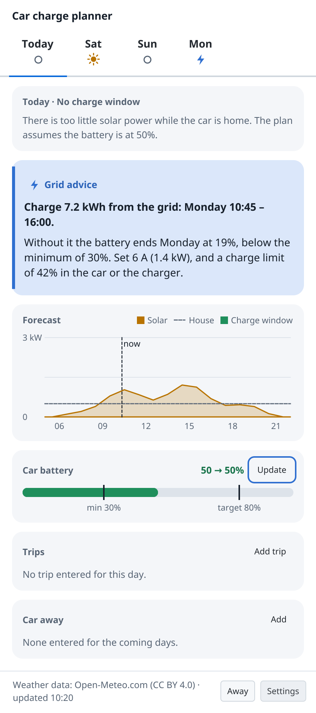
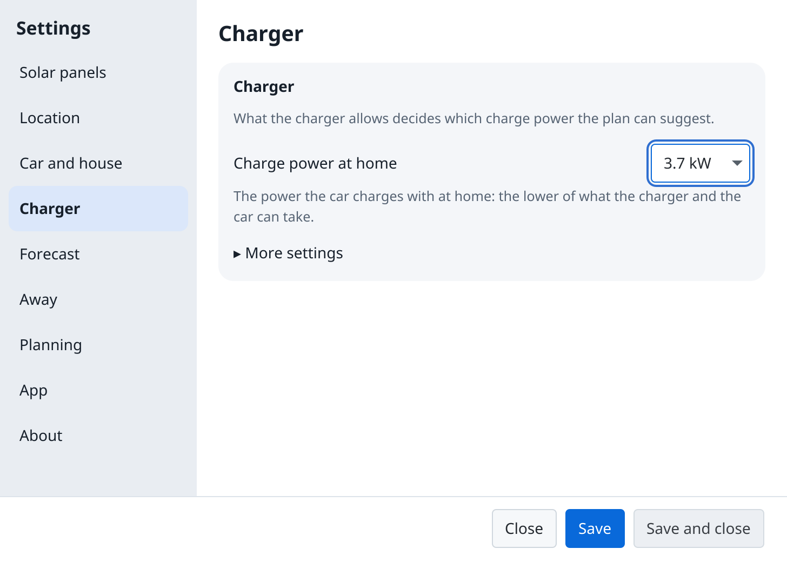

# Accessibility

The dashboard, Settings and set-up are made to be used with a keyboard only, with a screen reader, in light and dark, and at 150 and 200% scaling. This page says what works on which system, and what does not yet.

- **Keyboard.** Tab and Shift+Tab reach every control in reading order, and the control with the focus has a ring around it. Enter saves or goes on (Save, Next, an entry's Save), Escape cancels or closes (Close, Cancel, an entry's Cancel, the popup); while Settings or set-up asks whether to throw away your changes, Escape keeps them. The arrow keys move between the day tabs, the categories of Settings, and along the solar chart, which reads out each hour's values. On Windows, Win+B and the arrow keys reach the tray icon: Enter opens the dashboard, and the menu key opens its menu.
- **Screen readers.** On Windows, Narrator and NVDA read every control by a name of its own (a button such as Remove says what it removes), each day's main card and chart as one sentence, and what a Save or a refused value says. On Linux, **Orca cannot read the app**: JavaFX, the toolkit the app is built with, has no AT-SPI support. [#132](https://github.com/Enadeag/car-charge-planner/issues/132) follows OpenJFX for it. macOS is not built yet.
- **Contrast.** Every text reaches WCAG AA (4.5:1), and every glyph, chart line and focus ring 3:1, in light and in dark. Colour never carries a meaning alone: the source colours always come with a glyph or a word.
- **Scaling.** The app follows the system's display scaling on Linux and Windows. At 150 and 200% nothing is cut off; Settings and set-up are never larger than the screen, and their pages scroll.
- **Text size.** On Windows the app also follows **Text size** (Settings, Accessibility): the text in every window grows by as much, also when you change it while the app runs; Settings and set-up open as much larger. On Linux, GNOME's **Large Text** (text scaling factor) and KDE's forced font DPI reach the app through the screen's DPI, which makes the whole window larger, as display scaling does.

<picture><source media="(prefers-color-scheme: dark)" srcset="screenshots/java/dashboard-200-dark.png"></picture>
<picture><source media="(prefers-color-scheme: dark)" srcset="screenshots/java/settings-200-dark.png"></picture>

## Android

The Android app is not released yet. Its set-up, the screen of a settings file it cannot use, its plain home and its Settings are made for TalkBack and for Android's largest font, but they are **not yet checked with TalkBack** on a phone: the maintainer walks them before the first release.

- **TalkBack.** Every control has a name of its own and a role (button, radio button, check box), and every field a real label, a one-line hint and, after Next, its problem under it, which TalkBack reads with the field. Each step of set-up starts with a heading that says "Step 3 of 7", and the focus moves to that heading on a new step; after a Next or Finish that finds a problem, it moves to the first field that has one, from the top. The weekday group, the time fields and Remove of a weekly away period name the period ("Away until, period 2"), so TalkBack says which period a problem is in; the weekday's radio buttons are named by the day, inside the named group. A typical value is marked with the words "Typical value", never by colour alone. What the engine or the system says about a problem stays English, and TalkBack reads it as English. The answer of the place search, of the forecast check, and a Finish or a move of the settings file that failed are live regions, which TalkBack reads when they come in. Signed numbers (latitude, longitude, the panels' direction) have a key of their own for the minus, which a phone's number pad may lack.
- **Settings.** Each page's title in the top app bar is its heading and takes the focus when the page opens; Up is an arrow named "Back", and does what the system's Back does. Each row of the list is one button that reads the page's name and its values now. After a Save that finds a problem, the focus moves to the first field that has one, also to the fallback provider's choice. A panel array's heading names its place and its name ("Array 2, east roof"); its fields and buttons name its place ("Tilt, array 2"); the last array's Remove is off, and TalkBack reads why with it. Show and Hide of an API key say whose key they show, and the key stays a password field for TalkBack also while it is shown. What a Save came to stays in view under the top app bar while the page scrolls; it and what a connection check came to are live regions, read as one sentence, and a failed save is read at once. On the home, Settings is a gear named "Settings"; a save's outcome shown there is read at once when it failed, and after Close the focus goes to the home's title. The keyboard's action key is Next on every field but a page's last, where it is Done.
- **Size.** Every control is drawn at least 48 by 48 dp, buttons too, which Material draws at 40 dp, and each row of Settings' list at least 56 dp high. Each screen is one column of at most about 600 dp that scrolls, so nothing is cut off at 200% font size, also with the keyboard open; Save stays in the top app bar, in view.
- **Tests.** The screens' tests on Robolectric check on every pull request, at twice the font size, that every control has a name and a role, is drawn at least 48 dp in both directions (its own size, not the touch area, which Compose widens to 48 dp for anything clickable), and can be scrolled to, and that every page scrolls far enough to show its last control whole; and the names and sizes once more at the normal font size for each kind of screen, where a larger font no longer hides a button drawn too small. Compose's own accessibility checks (Google's Accessibility Test Framework) find nothing on Robolectric, so they are not used; what TalkBack really reads stays for the check by hand.

If you use a keyboard only or a screen reader every day, please tell us what does not work: open an issue with your system and screen reader.
