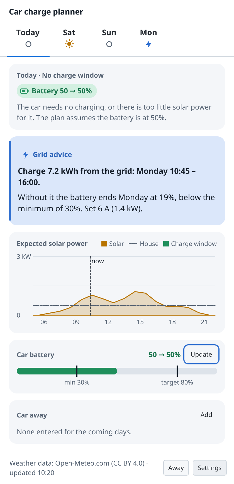
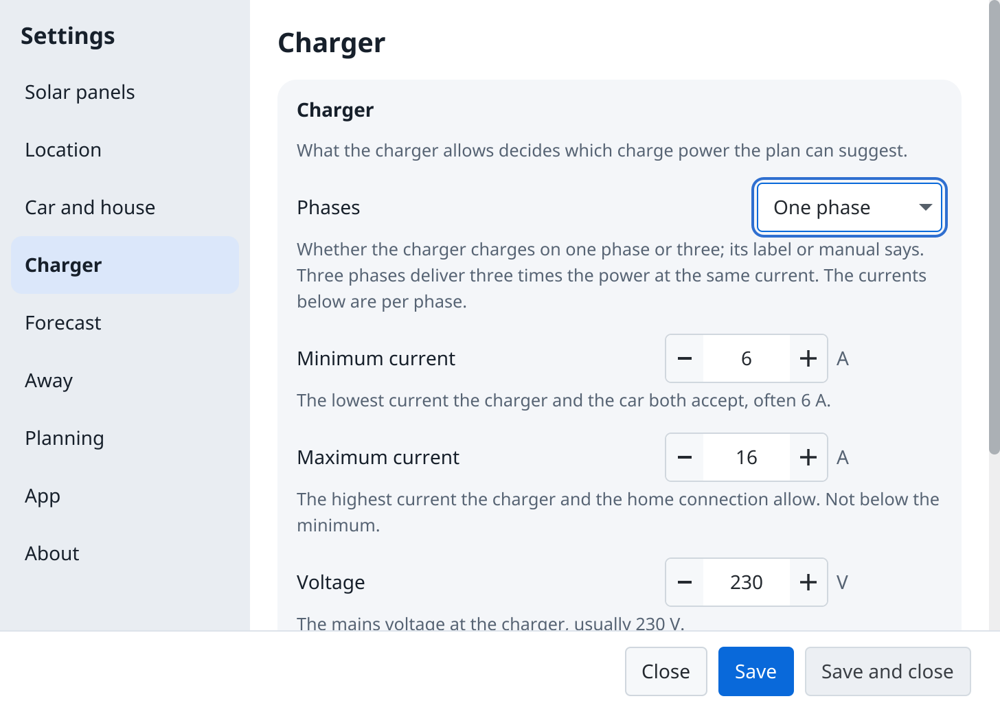

# Accessibility

The dashboard, Settings and set-up are made to be used with a keyboard only, with a screen reader, in light and dark, and at 150 and 200 % scaling. This page says what works on which system, and what does not yet.

- **Keyboard.** Tab and Shift+Tab reach every control in reading order, and the control with the focus has a ring around it. Enter saves or goes on (Save, Next, an entry's Save), Escape cancels or closes (Close, Cancel, an entry's Cancel, the popup); while Settings or set-up asks whether to throw away your changes, Escape keeps them. The arrow keys move between the day tabs, the categories of Settings, and along the solar chart, which reads out each hour's values. On Windows, Win+B and the arrow keys reach the tray icon: Enter opens the dashboard, and the menu key opens its menu.
- **Screen readers.** On Windows, Narrator and NVDA read every control by a name of its own (a button such as Remove says what it removes), each day's main card and chart as one sentence, and what a Save or a refused value says. On Linux, **Orca cannot read the app**: JavaFX, the toolkit the app is built with, has no AT-SPI support. [#132](https://github.com/Enadeag/car-charge-planner/issues/132) follows OpenJFX for it. macOS is not built yet.
- **Contrast.** Every text reaches WCAG AA (4.5:1), and every glyph, chart line and focus ring 3:1, in light and in dark. Colour never carries a meaning alone: the source colours always come with a glyph or a word.
- **Scaling.** The app follows the system's display scaling on Linux and Windows. At 150 and 200 % nothing is cut off; Settings and set-up are never larger than the screen, and their pages scroll. Windows' separate **Text size** setting is not followed yet: use **Scale** (Settings, System, Display) instead.

<picture><source media="(prefers-color-scheme: dark)" srcset="screenshots/java/dashboard-200-dark.png"></picture>
<picture><source media="(prefers-color-scheme: dark)" srcset="screenshots/java/settings-200-dark.png"></picture>

If you use a keyboard only or a screen reader every day, please tell us what does not work: open an issue with your system and screen reader.
