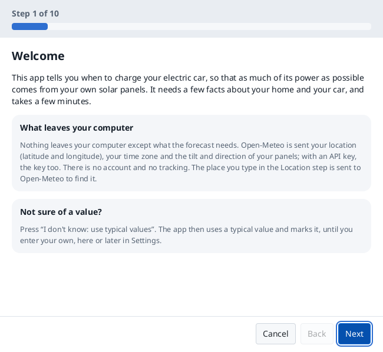
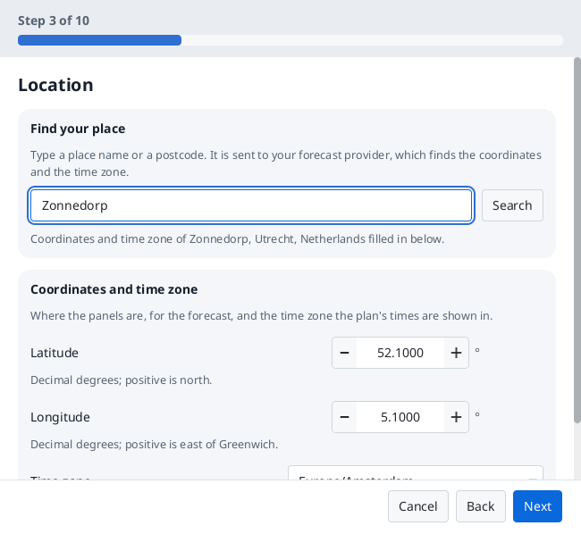
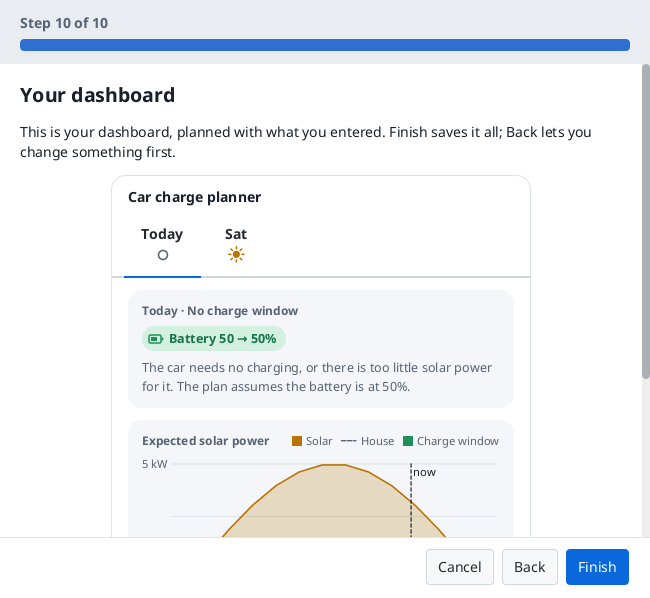

# Guide

How to use Car charge planner: set-up, the dashboard and the tray icon, Settings, how it plans, and its commands. [Installing](install.md) says how to get it on your computer. The words used here (surplus, charge window, away period and so on) are defined in [CONTEXT.md](../CONTEXT.md).

## Starting and quitting

Start the app from the Start menu (Windows) or with `bin/car-charge-planner` in the unpacked folder (Linux). It runs until you choose **Quit** in the tray icon's menu, or closes with its window when it shows a window instead of a tray icon. Starting it again while it runs does not start a second copy: the running one shows its dashboard.

## First run and set-up

Until you have said where your panels are, the app knows nothing about you: it **fetches nothing** (no request leaves your computer) and there is no plan. Set-up opens by itself the first time, and the dashboard and the tray menu lead back to it until it is done.

Set-up takes a few minutes. It starts with what leaves your computer, then asks for your language and units, the **place** of your panels (searched by name, or typed as coordinates), the panels' **size, direction and tilt** (more than one array if your panels face different ways), your **car** and **charger**, the forecast provider, and optionally more, such as the house's own use and when the car is away. Every question says where to find the answer, and a typical value is used where you don't know one. Before Finish it checks the forecast and shows a preview of the dashboard. **Nothing is saved until Finish**: cancelled, the app stays not set up.

<picture><source media="(prefers-color-scheme: dark)" srcset="screenshots/java/setup-welcome-english-dark.png"></picture>
<picture><source media="(prefers-color-scheme: dark)" srcset="screenshots/java/setup-location-english-dark.png"></picture>
<picture><source media="(prefers-color-scheme: dark)" srcset="screenshots/java/setup-preview-english-dark.png"></picture>

When the app is started hidden at login, set-up does not open by itself; one notification offers it.

## The tray icon and the dashboard

- The tray icon's dot shows the state of the plan, with the plan in its tooltip. Click it for the **dashboard**: a tab per day with that day's charge window, grid advice, the expected solar power against the house's use, and the car battery. The dashboard also opens in a window of its own.
- **Update** on the battery card is where you enter the level the car shows. Until you do, the plan assumes 50% and says so.
- **Add** on the Car away card marks the car away on the day you are looking at, all day or from a time to a time; the card lists the coming ones, each with **Remove**. The plan changes at once. Weekly away periods are in Settings, which the footer's **Away** button opens.
- Right-click the icon for **Open dashboard**, **Settings…** (**Set up…** until the app is set up), **About…** and **Quit**.
- A desktop notification comes a few minutes before each charge window (the lead time is a setting), once per window. Clicking it opens the dashboard. On Linux notifications go straight to the desktop's notification service over D-Bus, so they work with or without a tray; on Windows they come from the tray icon.

## Settings

Open **Settings…** from the tray menu or the dashboard. Settings is a window with a page per category: Solar panels, Location, Car and house, Charger, Forecast, Away, Planning, App and About.

| Page | What it holds |
| --- | --- |
| Solar panels | The panel arrays: size, tilt, direction and losses of each. The forecast is the sum of the arrays. |
| Location | Latitude, longitude and time zone, or a place search. |
| Car and house | The car's usable battery capacity, consumption and distance per day; the house's baseload. |
| Charger | One or three phases, minimum and maximum charge current, voltage, charging efficiency. |
| Forecast | Which forecast provider to use, an optional fallback, and each one's settings (a server address or an API key, if it takes any), with a **Test** button. API keys are kept in the system keychain. |
| Away | The weekly away periods: when the car is not at home every week. |
| Planning | Minimum and target charge level, the planning margin, the import tolerance, the minimum charge window length, the notification lead time. |
| App | Language, light or dark, units (metric or imperial), whether the app shows a tray icon or a window, and start at login. Set-up can be run again from here. |
| About | The version, the licence, the source, and where your files are kept. |

**Save** checks everything together. If something is wrong, it says what and writes nothing; otherwise the change applies at once. How the app shows itself (tray icon or window) applies the next time it starts.

## How it plans, briefly

1. Surplus per step = the forecast provider's expected solar power minus the house's own use, scaled by a planning margin (85% by default) so it errs towards too little power rather than grid draw.
2. A step counts only if the surplus covers at least your charger's minimum charge current (6 A by default: about 1.4 kW on a single-phase 230 V charger, about 4.1 kW on a three-phase one).
3. Within the hours the car is home, it picks the window and power that bring in the most solar for the energy the car needs, up to your target charge level (80% by default).
4. It projects the battery day by day, subtracting your distance per day. If a day would end under your minimum charge level, it adds grid advice.
5. A window you have been notified about is kept as announced while it runs, so the power on screen matches what you set.

## Limits to know about

- **The plan is forecast-only.** It uses a weather forecast and the values you enter, not measured data: no smart-meter, inverter or car readings. The more accurate your panel, battery and consumption values, the better the plan.
- **You enter the battery level by hand**, and the times the car is away: weekly in Settings, or for a single day on the dashboard. There is no calendar sync and no connection to the car.

## The command line

The program also takes a few commands:

| Command | What it does |
| --- | --- |
| `car-charge-planner quit` | Asks the running app to quit. It ends with exit code 3 when the app runs but cannot be reached. |
| `car-charge-planner test-notification` | Asks the running app to show a test notification, to check that notifications reach you and that clicking one opens the dashboard. Nothing is planned or recorded for it. It ends with exit code 4 when the app does not run, and with exit code 3 when it runs but cannot be reached. |
| `car-charge-planner start-at-login on` | Starts the app at login, hidden in the tray. The same as the switch in Settings, App. |
| `car-charge-planner start-at-login off` | Stops starting it at login. |
| `car-charge-planner install-launcher` | Linux only: adds the app to the application menu, with its icons. Run it again after moving the folder. |
| `car-charge-planner uninstall-launcher` | Linux only: removes what `install-launcher` wrote. |
| `--config=path/to/engine.json` | Plans with another settings file, such as `docs/example-engine.json`. |

## The files and the log

The app keeps its settings, your entries, a forecast cache and a log of what it did in files on your computer; [What is kept, and where](privacy.md#what-is-kept-and-where) lists them per system.

[`docs/example-engine.json`](example-engine.json) shows every setting of `engine.json`, for a made-up place. The app reads the files when it starts and writes them whole when you save; edit one by hand only while the app is closed. Each file says which version of its shape it holds (`"version": 1`); one without it, from before, is read as version 1, and one written by a newer version of the app is not used. A file the app cannot use, such as a damaged one, is never overwritten: before it saves, the app renames it to `<name>.damaged-<date>-<time>` (UTC) and logs that, so you can still recover what it held. Delete the data folder to reset your entries and the cache.
