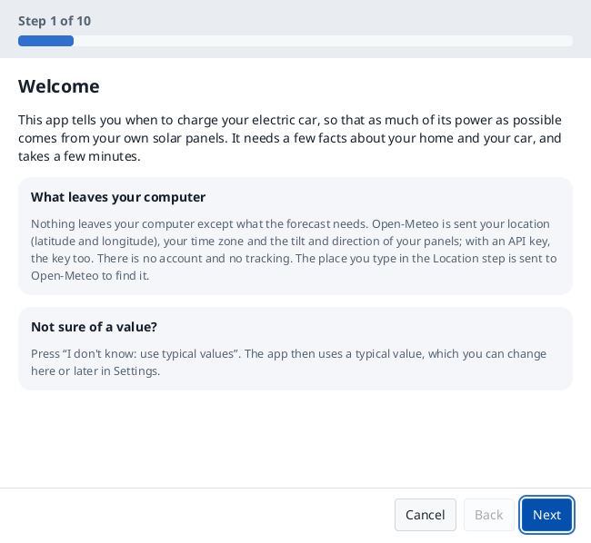
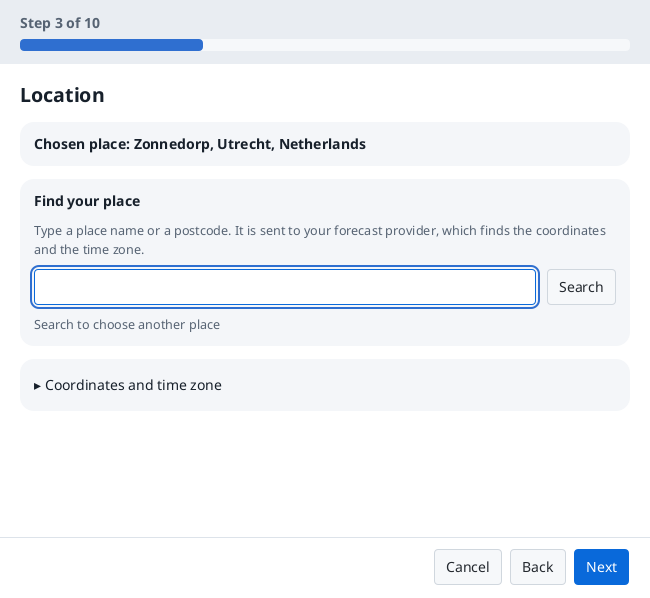
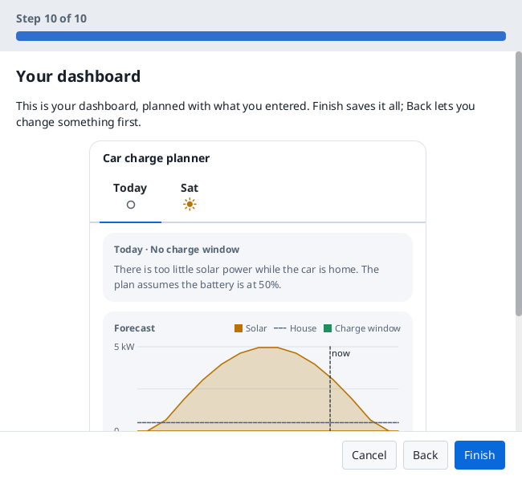
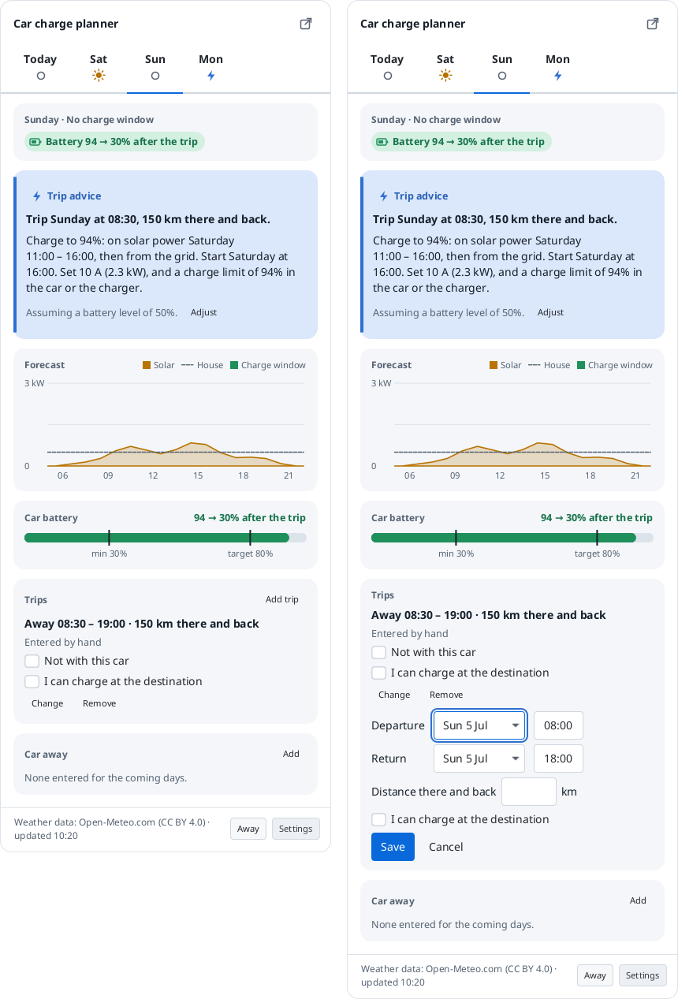

# Guide

How to use Car charge planner: set-up, the dashboard and the tray icon, Settings, how it plans, and its commands. [Installing](install.md) says how to get it on your computer. The words used here (surplus, charge window, away period and so on) are defined in [CONTEXT.md](../CONTEXT.md).

## Starting and quitting

Start the app from the Start menu (Windows) or with `bin/car-charge-planner` in the unpacked folder (Linux). It runs until you choose **Quit** in the tray icon's menu, or closes with its window when it shows a window instead of a tray icon. Starting it again while it runs does not start a second copy: the running one shows its dashboard.

## First run and set-up

Until you have said where your panels are, the app knows nothing about you: it **fetches nothing** (no request leaves your computer) and there is no plan. Set-up opens by itself the first time, and the dashboard and the tray menu lead back to it until it is done.

Set-up takes a few minutes. It starts with what leaves your computer, then asks for your language and units, the **place** of your panels (searched by name, or typed as coordinates under **Coordinates and time zone**), your panels: their **number, direction, tilt and the year they were placed**, and the power per panel if you know it (more than one array if your panels face different ways), your **car**, the **charge power at home** (which you must choose: it decides from how much solar power the car can charge), the forecast provider, and optionally when the car is away each week. It does not ask for the house's own use: it plans with a typical household's, which you can change in Settings. Every question says where to find the answer; where you don't know a value, **I don't know: use typical values** fills in a typical one, which you can change there or later in Settings. Before Finish it checks the forecast and shows a preview of the dashboard. **Nothing is saved until Finish**: cancelled, the app stays not set up.

<picture><source media="(prefers-color-scheme: dark)" srcset="screenshots/java/setup-welcome-english-dark.png"></picture>
<picture><source media="(prefers-color-scheme: dark)" srcset="screenshots/java/setup-location-english-dark.png"></picture>
<picture><source media="(prefers-color-scheme: dark)" srcset="screenshots/java/setup-preview-english-dark.png"></picture>

When the app is started hidden at login, set-up does not open by itself; one notification offers it.

## The tray icon and the dashboard

- The tray icon's dot shows the state of the plan, with the plan in its tooltip. Click it for the **dashboard**: a tab per day with that day's charge window, grid advice, the expected solar power against the house's use, and the car battery. The dashboard also opens in a window of its own.
- A day without a charge window says why. **Charging not needed**: the battery already shows the level the plan charges to, your target charge level or more before a trip. **No charge window** with "There is too little solar power while the car is home.": the car could use a charge, but the sun is gone for the day, the car is away in the sunny hours, no stretch is long or strong enough for the charger, or the forecast is weak. The Car battery card below shows the levels on every day.
- **Update** on the battery card is where you enter the level the car shows. Until you do, the plan assumes 50% and says so.
- **Add** on the Car away card marks the car away on the day you are looking at, all day or from a time to a time; the card lists the coming ones, each with **Remove**. The plan changes at once. Weekly away periods are in Settings, which the footer's **Away** button opens.
- **Add trip** on the Trips card enters a drive from home and back; each day's tab lists the trips the car is away for that day. [Trips](#trips) says how.
- Right-click the icon for **Open dashboard**, **Settings…** (**Set up…** until the app is set up), **About…** and **Quit**.
- A desktop notification comes a few minutes before each charge window (the lead time is a setting, and "At the start" tells you at the start, or when the app first sees the window running), once per window; trips have their own [notifications](#notifications-for-trips). Clicking it opens the dashboard. On Linux notifications go straight to the desktop's notification service over D-Bus, so they work with or without a tray; on Windows they come from the tray icon.

<picture><source media="(prefers-color-scheme: dark)" srcset="screenshots/java/dashboard-trip-dark.png"></picture>

## Trips

A **trip** is a drive from home and back that needs more than the battery holds on an ordinary day, such as a day out at 150 km. Enter it, and the plan makes sure the battery is full enough at the **departure**; the short drives you do every day are not trips (see [Daily distance and the trip surcharge](#daily-distance-and-the-trip-surcharge)).

### Entering a trip

On the dashboard, **Add trip** on the Trips card (below the battery card) opens a form for a trip that leaves on the day you are looking at:

- the day and time of the **departure** and of the **return**,
- the **distance there and back**,
- **I can charge at the destination**: tick it when you can charge where you are going. The plan then counts on half the distance having to come from your battery.

Each day's tab lists the trips the car is away for that day, each with **Change** and **Remove**, and a second choice that is easy to miss:

- **Not with this car** keeps the trip in the list, but the plan ignores it: the car stays home and is charged as on any other day. Untick it again when the car goes after all. Use it for a trip you take in another car, instead of removing it.

A trip is kept until a day after its return, then it is dropped. The plan changes at once after you add, change or remove one. The picture above shows a day with a trip, the advice for it and **Add trip** open.

### How the plan treats a trip

- **The trip comes first.** The plan works out the energy the trip needs (the distance, the car's consumption and the [trip surcharge](#daily-distance-and-the-trip-surcharge)), adds the daily distance of the days it is away and your minimum charge level, and makes sure the battery holds that at the departure.
- **Solar first, the grid for the rest.** The plan charges from solar power before the departure as far as it can, and asks the grid only for what is still missing.
- **Above the target level for a trip.** Your target charge level (80% by default) holds for every other day, but for a trip the plan charges higher, up to 100%, when the trip needs it. It does so as late as possible, so the battery stays at the higher level for as short a time as it can.
- **The grid part is done an hour before the departure**, and it starts as late as the [charging hours](#charging-hours) allow, so the battery is not full for long. When there is no stretch left that would bring enough, it says to start now.
- **Trips close together are charged for together.** When there is no time or sun to charge between two trips, the first charge also covers the second; at most 100% fits, so the last trip can still come out short.
- **Km short.** When even a full battery is not enough for a trip, the advice says how many kilometres the battery is short and to plan a charging stop on the way. The notification says the same.

### The trip advice

Each trip with something to do has a **trip advice** card below the day card, on today's tab and always on the day of the departure. It names the trip ("Trip Sunday at 08:30, 150 km there and back"), the level to charge to, the solar part and the grid part with the time to start, and the charge limit to set. It says which battery level it assumes, with an **Adjust** button that opens the entry of today's battery level: a trip is where a wrong level costs most, so enter the one the car shows. When the plan already charges enough, the card says so.

The day card of the day a trip leaves shows the level before and after the trip, and on the days the car is away on a trip it says that the car is away. A day before a trip on which the plan charges above the target says **No charge window** when no solar window comes and the battery is below what the trip needs. A day on which the trip's grid charge starts always says **No charge window**, never **Charging not needed**, also when the battery already shows what the trip needs: the day's own driving takes it below that before the charge.

### Charging hours

**Start charging between** (Settings, Planning; 07:00 to 22:00 unless you change it) are the hours in which you can start a charge. Every grid charge, for a trip or not, starts within them, and may run on after them: a charge that starts at 21:00 can go on through the night. The hours may span midnight, such as 20:00 to 02:00. Because of it, grid advice starts at 07:00 rather than in the middle of the night, and a charge for an early trip starts the evening before. When it is too late to wait for the hours to begin, the advice says to start now.

### Setting the charge limit

The app does not control your charger or your car. For a grid charge, the advice names a **charge limit**, such as "Set 10 A (2.3 kW), and a charge limit of 94% in the car or the charger": the battery level at which charging should stop, so that it brings the battery to what the plan needs and not further. Set it in the car's charging settings or in your charger's app, whichever you have, and the charge current as well. The notifications name it too.

### Daily distance and the trip surcharge

Two settings on the Car and house page of Settings belong to trips:

- **Daily distance** is how far you drive on a normal day, for example for shopping, school or sport; trips you enter separately do not count. It was called Other driving per day. The plan takes it off the battery every day, and trips come on top of it.
- **Trip surcharge** (15% unless you change it), under **More settings**, is added to the car's consumption for the energy of a trip: long drives on motorways, and drives in winter, use more than the average. Raise it when the plan keeps leaving you short, lower it for a car that is frugal on long drives. Set-up does not ask for it.

### Notifications for trips

Only when a trip asks for it, and never for a trip that is not with this car:

- **Start charging**: shortly before a trip's grid charge begins (at its start with a lead of 0), with the time, and the charge limit to set. When little time is left it says to start now.
- **Check the battery level**: the plan assumes a level until you enter one, and for a trip that needs a grid charge, or has little to spare, it asks whether it is right, when you have not entered one in the last 12 hours. It comes within the charging hours, from the day before the departure, and again only if the trip comes to need much more from the grid. The button (**Enter battery level**) opens the entry of the level; a click on the notification does the same.
- **Plan a charging stop**: from 19:00 the day before a trip the battery cannot make, with the number of kilometres short.

Like the notifications for charge windows, they do not come while the forecast is more than 6 hours old, and each comes once per trip.

## Settings

Open **Settings…** from the tray menu or the dashboard. Settings is a window with a page per category: Solar panels, Location, Car and house, Charger, Forecast, Away, Planning, App and About.

| Page | What it holds |
| --- | --- |
| Solar panels | The panel arrays: of each the number of panels, direction, tilt, year placed and power per panel, with the peak power they give together, and under **More settings** the losses and the name. The forecast is the sum of the arrays. |
| Location | The place you chose ("Chosen place: …", or "No place chosen yet"), a place search to choose another, and the latitude, longitude and time zone folded under **Coordinates and time zone**, which opens by itself without a place or when a coordinate has a problem. The place's name is kept with the coordinates and goes when you type other ones. With a forecast provider that has no place search, only the coordinates and the time zone. |
| Car and house | The car's usable battery capacity, consumption and daily distance; under **More settings** the trip surcharge and the **household use**: what the house uses in kWh per day, without charging the car, as your energy supplier shows it per day (12 kWh, a typical household, until you enter yours). |
| Charger | The **charge power at home**: 3.7 kW, 7.4 kW, 11 kW, 22 kW or **Other**, the lower of what the charger and the car can take. Under **More settings**: one or three phases, minimum and maximum charge current, voltage and charging efficiency, with "I don't know" for the last three. |
| Forecast | Which forecast provider to use, an optional fallback, and each one's settings, with a **Test** button. A provider's optional settings are folded under **API key and server** (Open-Meteo) or **API key** (Forecast.Solar): the free services need neither. The fold is open when you stored a key or a server address of your own, or while the keychain is locked, and stays closed while you have Settings open once you close it. API keys are kept in the system keychain. |
| Away | The weekly away periods: when the car is not at home every week. |
| Planning | Minimum and target charge level, the hours you can start charging and the notification lead time, chosen from at the start or 5, 10, 15, 30 or 60 minutes ahead (a lead saved before that is none of these stays as it is until you choose another); under **More settings** the planning margin, the import tolerance and the minimum charge window length. |
| App | Language, light or dark, units (metric or imperial), whether the app shows a tray icon or a window, and start at login. Set-up can be run again from here. |
| About | The version, the licence, the source, and where your files are kept. |

The power per panel (Wp) is on the invoice or the panel itself. Left empty, the app counts on the usual power of a panel placed in that year, from 220 Wp up to 2010 to 430 Wp from 2024, which may be 30 to 40 Wp off; the field shows it in grey. An array entered in an older version as a size in kWp says "Now set: … kWp" and keeps that size until you enter its number of panels. A tilt or direction entered in degrees shows as the nearest choice and stays as it is until you choose.

A charge power fills in the phases and the maximum charge current at 230 V: 3.7 kW is one phase of 16 A, 7.4 kW one phase of 32 A, 11 kW three phases of 16 A and 22 kW three phases of 32 A; the minimum current and the efficiency stay as they are. The field always shows the power the settings under **More settings** give, and **Other** when they give none of the four, such as at 240 V or 25 A; **Other** opens those settings and changes nothing. If your charger has three phases but your car charges on one, choose 3.7 or 7.4 kW: that sets one phase, which is what the plan needs, as the car then charges from about 1.4 kW of solar power instead of 4.1 kW.

**Save** checks everything together. If something is wrong, it says what and writes nothing; otherwise the change applies at once. How the app shows itself (tray icon or window) applies the next time it starts.

## How it plans, briefly

1. Surplus per step = the forecast provider's expected solar power minus the house's own use, scaled by a planning margin (85% by default) so it errs towards too little power rather than grid draw.
2. A step counts only if the surplus covers at least your charger's minimum charge current (6 A by default: about 1.4 kW on a single-phase 230 V charger, about 4.1 kW on a three-phase one).
3. Within the hours the car is home, it picks the window and power that bring in the most solar for the energy the car needs, up to your target charge level (80% by default).
4. It projects the battery day by day, subtracting your daily distance (what you drive on a normal day, trips apart). If a day would end under your minimum charge level, it adds grid advice. A [trip](#how-the-plan-treats-a-trip) is planned first, with its own energy.
5. A window you have been notified about is kept as announced while it runs, so the power on screen matches what you set.

## Limits to know about

- **The plan is forecast-only.** It uses a weather forecast and the values you enter, not measured data: no smart-meter, inverter or car readings. The more accurate your panel, battery and consumption values, the better the plan.
- **You enter the battery level by hand**, and the times the car is away and your trips: weekly away periods in Settings, the rest on the dashboard. There is no calendar sync and no connection to the car.

## The command line

The program also takes a few commands:

| Command | What it does |
| --- | --- |
| `car-charge-planner quit` | Asks the running app to quit. It ends with exit code 3 when the app runs but cannot be reached. |
| `car-charge-planner test-notification` | Asks the running app to show a test notification, to check that notifications reach you and that clicking one opens the dashboard. Nothing is planned or recorded for it. It ends with exit code 4 when the app does not run, and with exit code 3 when it runs but cannot be reached. |
| `car-charge-planner start-at-login on` | Starts the app at login, hidden in the tray. The same as the switch in Settings, App. |
| `car-charge-planner start-at-login off` | Stops starting it at login. |
| `car-charge-planner install-launcher` | Linux only: adds the app to the application menu, with its icons. Run it again after moving the folder. Installed from the `.deb` or `.rpm`, the app is in the menu already, and this says so. |
| `car-charge-planner uninstall-launcher` | Linux only: removes what `install-launcher` wrote. |
| `--config=path/to/engine.json` | Plans with another settings file, such as `docs/example-engine.json`. |

## The files and the log

The app keeps its settings, your entries, a forecast cache and a log of what it did in files on your computer; [What is kept, and where](privacy.md#what-is-kept-and-where) lists them per system.

[`docs/example-engine.json`](example-engine.json) shows every setting of `engine.json`, for a made-up place. The app reads the files when it starts and writes them whole when you save; edit one by hand only while the app is closed. Each file says which version of its shape it holds, such as `"version": 2` in `engine.json`, which a panel array's number of panels and the place's name (`placeName`) need; one without it, from before, is read as version 1, and one written by a newer version of the app is not used, so a settings file saved by this version cannot be read by 0.6.0 or older. A file the app cannot use, such as a damaged one, is never overwritten: before it saves, the app renames it to `<name>.damaged-<date>-<time>` (UTC) and logs that, so you can still recover what it held. A file written by a newer version of the app is never overwritten, renamed or removed: saving then fails, until you update the app. Delete the data folder to reset your entries and the cache.
