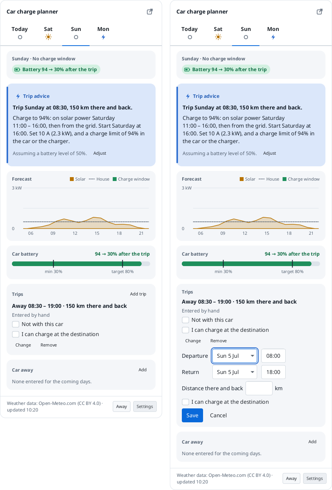

# Guide

How to use Car charge planner: set-up, the dashboard and the tray icon, Settings, how it plans, and its commands. [Installing](install.md) says how to get it on your computer. The words used here (surplus, charge window, away period and so on) are defined in [CONTEXT.md](../CONTEXT.md).

## Starting and quitting

Start the app from the Start menu (Windows) or with `bin/car-charge-planner` in the unpacked folder (Linux). It runs until you choose **Quit** in the tray icon's menu, or closes with its window when it shows a window instead of a tray icon. Starting it again while it runs does not start a second copy: the running one shows its dashboard.

## First run and set-up

Until you have said where your panels are, the app knows nothing about you: it **fetches nothing** (no request leaves your computer) and there is no plan. Set-up opens by itself the first time, and the dashboard and the tray menu lead back to it until it is done.

Set-up takes a few minutes. It starts with what leaves your computer, then asks for your language and units, the **place** of your panels (searched by name, or typed as coordinates), the panels' **size, direction and tilt** (more than one array if your panels face different ways), your **car** and **charger**, the forecast provider, and optionally more, such as the house's own use and when the car is away. Every question says where to find the answer, and a typical value is used where you don't know one. Before Finish it checks the forecast and shows a preview of the dashboard. **Nothing is saved until Finish**: cancelled, the app stays not set up.

<picture><source media="(prefers-color-scheme: dark)" srcset="screenshots/java/setup-welcome-english-dark.png"></picture>
<picture><source media="(prefers-color-scheme: dark)" srcset="screenshots/java/setup-location-english-dark.png"></picture>
<picture><source media="(prefers-color-scheme: dark)" srcset="screenshots/java/setup-preview-english-dark.png"></picture>

When the app is started hidden at login, set-up does not open by itself; one notification offers it.

## The tray icon and the dashboard

- The tray icon's dot shows the state of the plan, with the plan in its tooltip. Click it for the **dashboard**: a tab per day with that day's charge window, grid advice, the expected solar power against the house's use, and the car battery. The dashboard also opens in a window of its own.
- **Update** on the battery card is where you enter the level the car shows. Until you do, the plan assumes 50% and says so.
- **Add** on the Car away card marks the car away on the day you are looking at, all day or from a time to a time; the card lists the coming ones, each with **Remove**. The plan changes at once. Weekly away periods are in Settings, which the footer's **Away** button opens.
- **Add trip** on the Trips card enters a drive from home and back; each day's tab lists the trips the car is away for that day. [Trips](#trips) says how.
- Right-click the icon for **Open dashboard**, **Settings…** (**Set up…** until the app is set up), **About…** and **Quit**.
- A desktop notification comes a few minutes before each charge window (the lead time is a setting), once per window; trips have their own [notifications](#notifications-for-trips). Clicking it opens the dashboard. On Linux notifications go straight to the desktop's notification service over D-Bus, so they work with or without a tray; on Windows they come from the tray icon.

<picture><source media="(prefers-color-scheme: dark)" srcset="screenshots/java/dashboard-trip-dark.png"></picture>

## Trips

A **trip** is a drive from home and back that needs more than the battery holds on an ordinary day, such as a day out at 150 km. Enter it, and the plan makes sure the battery is full enough at the **departure**; the short drives you do every day are not trips (see [Other driving and the trip surcharge](#other-driving-and-the-trip-surcharge)).

### Entering a trip

On the dashboard, **Add trip** on the Trips card (below the battery card) opens a form for a trip that leaves on the day you are looking at:

- the day and time of the **departure** and of the **return**,
- the **distance there and back**,
- **I can charge at the destination**: tick it when you can charge where you are going. The plan then counts on half the distance having to come from your battery.

Each day's tab lists the trips the car is away for that day, each with **Change** and **Remove**, and a second choice that is easy to miss:

- **Not with this car** keeps the trip in the list, but the plan ignores it: the car stays home and is charged as on any other day. Untick it again when the car goes after all. Use it for a trip you take in another car, instead of removing it.

A trip is kept until a day after its return, then it is dropped. The plan changes at once after you add, change or remove one. The picture above shows a day with a trip, the advice for it and **Add trip** open.

### How the plan treats a trip

- **The trip comes first.** The plan works out the energy the trip needs (the distance, the car's consumption and the [trip surcharge](#other-driving-and-the-trip-surcharge)), adds the other driving of the days it is away and your minimum charge level, and makes sure the battery holds that at the departure.
- **Solar first, the grid for the rest.** The plan charges from solar power before the departure as far as it can, and asks the grid only for what is still missing.
- **Above the target level for a trip.** Your target charge level (80% by default) holds for every other day, but for a trip the plan charges higher, up to 100%, when the trip needs it. It does so as late as possible, so the battery stays at the higher level for as short a time as it can.
- **The grid part is done an hour before the departure**, and it starts as late as the [charging hours](#charging-hours) allow, so the battery is not full for long. When there is no stretch left that would bring enough, it says to start now.
- **Trips close together are charged for together.** When there is no time or sun to charge between two trips, the first charge also covers the second; at most 100% fits, so the last trip can still come out short.
- **Km short.** When even a full battery is not enough for a trip, the advice says how many kilometres the battery is short and to plan a charging stop on the way. The notification says the same.

### The trip advice

Each trip with something to do has a **trip advice** card below the day card, on today's tab and always on the day of the departure. It names the trip ("Trip Sunday at 08:30, 150 km there and back"), the level to charge to, the solar part and the grid part with the time to start, and the charge limit to set. It says which battery level it assumes, with an **Adjust** button that opens the entry of today's battery level: a trip is where a wrong level costs most, so enter the one the car shows. When the plan already charges enough, the card says so.

The day card of the day a trip leaves shows the level before and after the trip, and on the days the car is away on a trip it says that the car is away, instead of that it needs no charging.

### Charging hours

**Start charging between** (Settings, Planning; 07:00 to 22:00 unless you change it) are the hours in which you can start a charge. Every grid charge, for a trip or not, starts within them, and may run on after them: a charge that starts at 21:00 can go on through the night. The hours may span midnight, such as 20:00 to 02:00. Because of it, grid advice starts at 07:00 rather than in the middle of the night, and a charge for an early trip starts the evening before. When it is too late to wait for the hours to begin, the advice says to start now.

### Setting the charge limit

The app does not control your charger or your car. For a grid charge, the advice names a **charge limit**, such as "Set 10 A (2.3 kW), and a charge limit of 94% in the car or the charger": the battery level at which charging should stop, so that it brings the battery to what the plan needs and not further. Set it in the car's charging settings or in your charger's app, whichever you have, and the charge current as well. The notifications name it too.

### Other driving and the trip surcharge

Two settings on the Car page of Settings (Car and house) belong to trips:

- **Other driving per day** is the average distance of the short drives that are not trips, such as shopping. It was called Distance per day. The plan takes it off the battery every day, and trips come on top of it.
- **Trip surcharge** (15% unless you change it) is added to the car's consumption for the energy of a trip: long drives on motorways, and drives in winter, use more than the average. Raise it when the plan keeps leaving you short, lower it for a car that is frugal on long drives. Set-up does not ask for it.

### Notifications for trips

Only when a trip asks for it, and never for a trip that is not with this car:

- **Start charging**: shortly before a trip's grid charge begins, with the time, and the charge limit to set. When little time is left it says to start now.
- **Check the battery level**: the plan assumes a level until you enter one, and for a trip that needs a grid charge, or has little to spare, it asks whether it is right, when you have not entered one in the last 12 hours. It comes within the charging hours, from the day before the departure, and again only if the trip comes to need much more from the grid. The button (**Enter battery level**) opens the entry of the level; a click on the notification does the same.
- **Plan a charging stop**: from 19:00 the day before a trip the battery cannot make, with the number of kilometres short.

Like the notifications for charge windows, they do not come while the forecast is more than 6 hours old, and each comes once per trip.

## Settings

Open **Settings…** from the tray menu or the dashboard. Settings is a window with a page per category: Solar panels, Location, Car and house, Charger, Forecast, Away, Planning, App and About.

| Page | What it holds |
| --- | --- |
| Solar panels | The panel arrays: size, tilt, direction and losses of each. The forecast is the sum of the arrays. |
| Location | Latitude, longitude and time zone, or a place search. |
| Car and house | The car's usable battery capacity, consumption, other driving per day and trip surcharge; the house's baseload. |
| Charger | One or three phases, minimum and maximum charge current, voltage, charging efficiency. |
| Forecast | Which forecast provider to use, an optional fallback, and each one's settings (a server address or an API key, if it takes any), with a **Test** button. API keys are kept in the system keychain. |
| Away | The weekly away periods: when the car is not at home every week. |
| Planning | Minimum and target charge level, the hours you can start charging, the planning margin, the import tolerance, the minimum charge window length, the notification lead time. |
| App | Language, light or dark, units (metric or imperial), whether the app shows a tray icon or a window, and start at login. Set-up can be run again from here. |
| About | The version, the licence, the source, and where your files are kept. |

**Save** checks everything together. If something is wrong, it says what and writes nothing; otherwise the change applies at once. How the app shows itself (tray icon or window) applies the next time it starts.

## How it plans, briefly

1. Surplus per step = the forecast provider's expected solar power minus the house's own use, scaled by a planning margin (85% by default) so it errs towards too little power rather than grid draw.
2. A step counts only if the surplus covers at least your charger's minimum charge current (6 A by default: about 1.4 kW on a single-phase 230 V charger, about 4.1 kW on a three-phase one).
3. Within the hours the car is home, it picks the window and power that bring in the most solar for the energy the car needs, up to your target charge level (80% by default).
4. It projects the battery day by day, subtracting your other driving per day (the short drives that are not trips). If a day would end under your minimum charge level, it adds grid advice. A [trip](#how-the-plan-treats-a-trip) is planned first, with its own energy.
5. A window you have been notified about is kept as announced while it runs, so the power on screen matches what you set.

## Limits to know about

- **The plan is forecast-only.** It uses a weather forecast and the values you enter, not measured data: no smart-meter, inverter or car readings. The more accurate your panel, battery and consumption values, the better the plan.
- **You enter the battery level by hand**, and the times the car is away and your trips: weekly away periods in Settings, the rest on the dashboard. There is no calendar sync and no connection to the car.

## The command line

The program also takes a few commands:

| Command | What it does |
| --- | --- |
| `car-charge-planner quit` | Asks the running app to quit. It ends with exit code 3 when the app runs but cannot be reached. |
| `car-charge-planner test-notification` | Asks the running app to show a test notification, to check that notifications reach you and that clicking one opens the dashboard. Nothing is planned or recorded for it. It ends with exit code 4 when the app does not run, and with exit code 3 when it runs but cannot be reached. |
| `car-charge-planner start-at-login on` | Starts the app at login, hidden in the tray. The same as the switch in Settings, App. |
| `car-charge-planner start-at-login off` | Stops starting it at login. |
| `car-charge-planner install-launcher` | Linux only: adds the app to the application menu, with its icons. Run it again after moving the folder. Installed from the `.deb` or `.rpm`, the app is in the menu already, and this says so. |
| `car-charge-planner uninstall-launcher` | Linux only: removes what `install-launcher` wrote. |
| `--config=path/to/engine.json` | Plans with another settings file, such as `docs/example-engine.json`. |

## The files and the log

The app keeps its settings, your entries, a forecast cache and a log of what it did in files on your computer; [What is kept, and where](privacy.md#what-is-kept-and-where) lists them per system.

[`docs/example-engine.json`](example-engine.json) shows every setting of `engine.json`, for a made-up place. The app reads the files when it starts and writes them whole when you save; edit one by hand only while the app is closed. Each file says which version of its shape it holds (`"version": 1`); one without it, from before, is read as version 1, and one written by a newer version of the app is not used. A file the app cannot use, such as a damaged one, is never overwritten: before it saves, the app renames it to `<name>.damaged-<date>-<time>` (UTC) and logs that, so you can still recover what it held. Delete the data folder to reset your entries and the cache.
